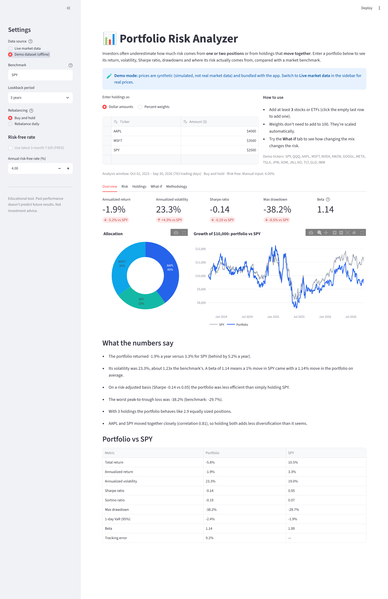
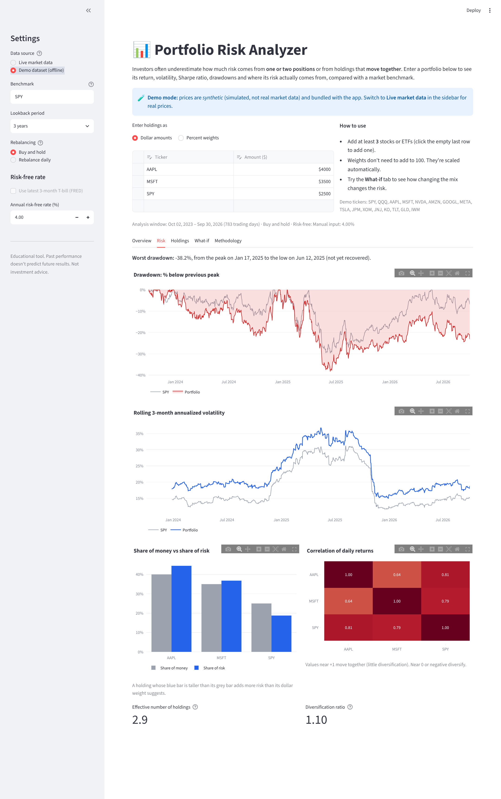
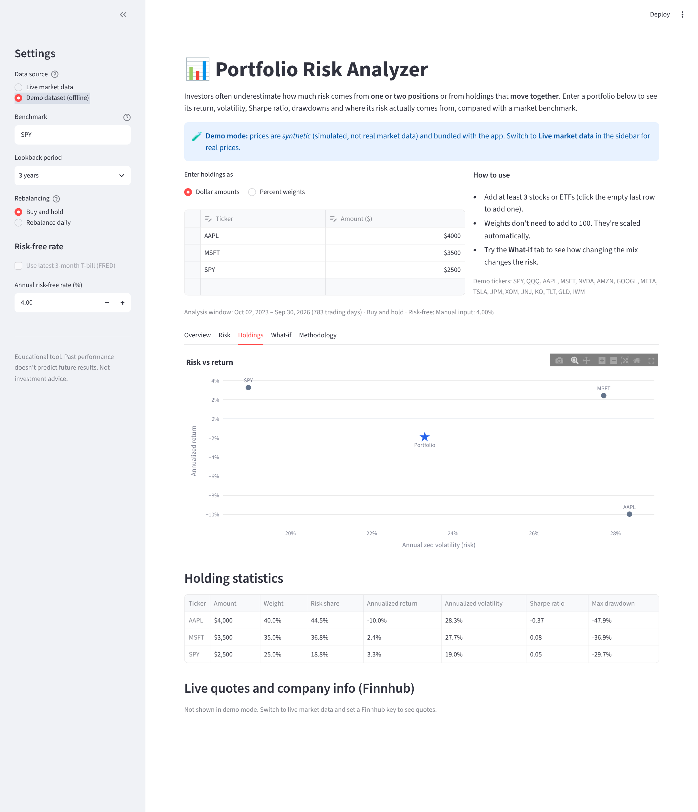
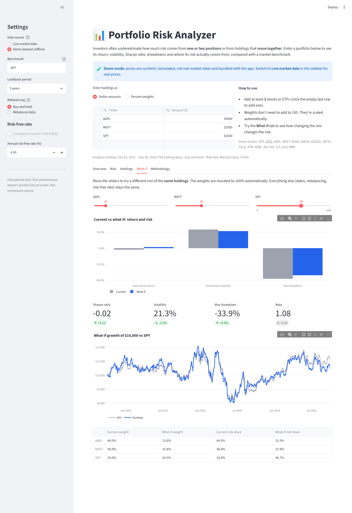

# 📊 Portfolio Risk Analyzer

An interactive Streamlit app that measures the **return and risk of a stock/ETF portfolio** and shows **where that risk actually comes from**, compared with a market benchmark.

**Financial problem (Project 2):** investors often underestimate the risk that comes from a single large position, or from holdings that look different but move together. This app makes that visible. Enter a few holdings and the app shows the portfolio's volatility, Sharpe ratio and worst drawdown. It also shows how much of the total risk each holding is responsible for, which is often more than its dollar weight.

> Educational tool. Historical results don't predict future returns, and nothing here is investment advice.

---

## Features

| Requirement | How the app covers it |
|---|---|
| Select at least 3 stocks or ETFs | Editable holdings table. Add any number of rows; the app requires at least 3 with data. |
| Investment amounts or weights | Toggle between **dollar amounts** and **percent weights**. Either is rescaled to 100%. |
| Portfolio returns | Total return, annualized return (CAGR), and growth-of-$X chart. Buy-and-hold or daily-rebalanced. |
| Volatility, Sharpe, max drawdown | Plus Sortino ratio, 1-day 95% historical VaR, beta and tracking error. |
| Allocation and performance charts | Allocation donut, growth vs benchmark, drawdown, rolling volatility, risk-vs-weight bars, correlation heatmap, risk/return scatter, what-if comparison. |
| Benchmark comparison | Any ticker as benchmark (default **SPY**). Side-by-side table and every chart overlays it. |
| Adjust allocations and see risk change | **What-if** tab: sliders re-weight the same holdings and show the change in Sharpe, volatility, drawdown, beta and risk share. |
| Live data | Yahoo Finance price history, Finnhub live quotes + company profiles, FRED 3-month T-bill rate. |
| Plain-language results | "What the numbers say" turns the metrics into short, data-backed sentences. |

## Screenshots

These were taken in **demo mode**, which uses the bundled *synthetic* dataset, so the numbers aren't real market results.

| Overview | Risk |
|---|---|
|  |  |

| Holdings | What-if |
|---|---|
|  |  |

---

## Run it

Requires **Python 3.10+**.

```bash
git clone https://github.com/<your-username>/portfolio-risk-analyzer.git
cd portfolio-risk-analyzer

python -m venv .venv
# macOS/Linux:
source .venv/bin/activate
# Windows:
.venv\Scripts\activate

pip install -r requirements.txt
streamlit run app.py
```

The app opens at http://localhost:8501.

* **Live market data** (the default) needs an internet connection. Historical prices and the risk-free rate need **no API key**.
* **Demo dataset (offline)** in the sidebar runs the whole app with no internet and no key, using `data/sample_prices.csv`.

### Optional: Finnhub API key (live quotes and company info)

1. Create a free account at <https://finnhub.io/register> and copy your API key from the dashboard.
2. Copy the example secrets file and paste your key in:

   ```bash
   cp .streamlit/secrets.toml.example .streamlit/secrets.toml
   ```

   ```toml
   FINNHUB_API_KEY = "your_key_here"
   ```

   You can set an environment variable instead: `export FINNHUB_API_KEY=your_key_here`.
3. Restart the app. The sidebar shows "Finnhub key: found ✅".

`.streamlit/secrets.toml` and `.env` are in `.gitignore`, so the key is never committed. Without a key the app still works. It just skips the live-quotes table.

### Run the tests

```bash
pytest
```

The tests run with no internet connection: 52 tests cover the math (checked against hand-worked examples), the data layer (network calls mocked) and the full app (launched headless with Streamlit's `AppTest`).

---

## Data sources and APIs

| Data | Source | Endpoint | Key? | Free-tier notes |
|---|---|---|---|---|
| Daily adjusted close prices | Yahoo Finance via [`yfinance`](https://github.com/ranaroussi/yfinance) | `yf.download(...)` | No | Open-source library. Prices are adjusted for splits and dividends. |
| Latest quote | [Finnhub](https://finnhub.io/docs/api/quote) | `GET /api/v1/quote` | Yes (free) | Free plan, ~60 calls/minute. |
| Company profile | [Finnhub](https://finnhub.io/docs/api/company-profile2) | `GET /api/v1/stock/profile2` | Yes (free) | Free plan. ETFs usually return an empty profile. |
| Risk-free rate | [FRED](https://fred.stlouisfed.org/series/DGS3MO) series **DGS3MO** | `fredgraph.csv?id=DGS3MO` | No | Public CSV download. |
| Demo prices | `data/sample_prices.csv` | Local file | No | **Synthetic.** See below. |

**Why not Finnhub for historical prices?** Finnhub's `/stock/candle` endpoint isn't part of the free plan, which a Finnhub maintainer [confirmed on GitHub](https://github.com/finnhubio/Finnhub-API/issues/546). The assignment allows "a permitted free historical-price source," so price history comes from Yahoo Finance. Finnhub is still used for what its free plan covers: live quotes and company profiles.

**Demo dataset.** `data/sample_prices.csv` holds ~4.7 years of *simulated* daily prices for 16 tickers (SPY, QQQ, AAPL, MSFT, NVDA, AMZN, GOOGL, META, TSLA, JPM, XOM, JNJ, KO, TLT, GLD, IWM). It's generated by `data/make_sample_data.py` with a one-factor market model, calm/stressed volatility regimes and fat-tailed shocks, using a fixed random seed so anyone can regenerate the same file. The ticker names only label how each series behaves (e.g. TLT has a negative market beta). **The prices are not real.**

---

## Financial concepts and calculations

All calculations live in [`analyzer/metrics.py`](analyzer/metrics.py) as small, tested functions. They assume 252 trading days per year.

| Measure | Formula | What it tells you |
|---|---|---|
| Daily return | r = Pₜ / Pₜ₋₁ − 1 | Day-to-day change |
| Portfolio value | Buy-and-hold: Σ wᵢ · Pᵢ,ₜ / Pᵢ,₀. Rebalanced: Π (1 + Σ wᵢ rᵢ,ₜ) | Growth of $1 |
| Annualized return (CAGR) | (V_end / V_start)^(252/N) − 1 | Compound yearly growth |
| Annualized volatility | stdev(daily r) × √252 | How much returns swing. The main "risk" number. |
| Sharpe ratio | mean(r − r_f/252) / stdev(r − r_f/252) × √252 | Return earned per unit of risk, above T-bills |
| Sortino ratio | Same numerator ÷ downside deviation | Like Sharpe, but only counts bad volatility |
| Maximum drawdown | min( Vₜ / max(V up to t) − 1 ) | Worst peak-to-trough loss, with peak, trough and recovery dates |
| Beta | Cov(r_p, r_b) / Var(r_b) | Sensitivity to the benchmark |
| Tracking error | stdev(r_p − r_b) × √252 | How differently it behaves from the benchmark |
| 1-day VaR (95%) | 5th percentile of daily returns | A "bad day" loss, seen about 1 day in 20 |
| Risk contribution | RCᵢ = wᵢ (Σw)ᵢ / wᵀΣw | Each holding's share of total variance. The shares add up to 100%. |
| Effective number of holdings | 1 / Σ wᵢ² (inverse Herfindahl) | How concentrated the portfolio really is |
| Diversification ratio | Σ wᵢ σᵢ / σ_p | How much combining assets lowers risk (1.0 = no benefit) |
| Correlation matrix | Pearson correlation of daily returns | Which holdings move together |

**How the results support decisions.** The risk-contribution chart shows whether one position is quietly driving the portfolio. In the default example, AAPL is 40% of the money but about 45% of the risk. The correlation heatmap flags holdings that don't actually diversify each other. The What-if tab lets the user test a new mix of the same holdings before making a change, and see how much volatility and drawdown it removes and what that does to the Sharpe ratio.

**Accuracy checks.**
- Every formula has a unit test against a value worked out by hand. For example, a 50/50 buy-and-hold where one asset doubles must end at 1.5. A 120 → 90 drop must be a −25% drawdown with the correct peak, trough and recovery dates.
- The app's headline numbers for the default portfolio were recomputed in plain Python with no pandas or numpy, and they matched to the decimal.

---

## Project structure

```
portfolio-risk-analyzer/
├── app.py                     # Streamlit interface (inputs, tabs, error messages)
├── analyzer/
│   ├── data_sources.py        # Finnhub, Yahoo Finance, FRED, demo data, input parsing
│   ├── metrics.py             # All financial calculations (pure functions)
│   └── charts.py              # Plotly figures
├── data/
│   ├── sample_prices.csv      # Synthetic demo dataset
│   └── make_sample_data.py    # Script that generates it
├── tests/                     # pytest suite (math, data layer, full app)
├── docs/
│   ├── screenshots/           # Screenshots used in this README
│   └── AI_DEVELOPMENT_LOG.md  # How the AI coding agent was used
├── .streamlit/secrets.toml.example
├── requirements.txt
└── .gitignore
```

## Error handling

The app never crashes on bad input or a failed API. It shows a message and keeps running:

- **Invalid ticker text** (spaces, symbols, too long): warning, and that row is skipped.
- **Negative or non-numeric amounts:** warning, and that row is skipped. Duplicate tickers are merged.
- **Fewer than 3 usable holdings:** clear error explaining what's needed.
- **Ticker with no price history:** dropped with a warning naming it, then the 3-holding check runs again.
- **Unknown benchmark:** error asking for a different one.
- **Short overlapping history** (e.g. a recent IPO): stats start when every holding has data, and the app says so. Under 60 days triggers an error.
- **Yahoo Finance down or rate-limited:** error message, plus a suggestion to switch to demo mode.
- **FRED unavailable:** falls back to a manual risk-free rate input.
- **Finnhub problems:** a bad key (401), the rate limit (429), a paid endpoint (403), an unknown symbol or no network each get their own message. The rest of the app still works.
- **What-if sliders all at zero:** warning instead of a divide-by-zero.

## How the AI coding agent was used

This app was built with **Claude (Anthropic)** as the AI coding agent. It worked iteratively: it wrote code, ran it, ran tests, took screenshots of the running app and fixed what it found. Bugs it caught along the way include a test path error, a floating-point edge case in the Sharpe ratio, overlapping chart legends, a duplicate benchmark point on the scatter plot and a mislabeled chart. See [`docs/AI_DEVELOPMENT_LOG.md`](docs/AI_DEVELOPMENT_LOG.md) for the step-by-step log.

## Known limitations and incomplete features

- **History isn't a forecast.** Volatility and correlations change over time and tend to spike together in crises.
- **Normality assumption.** Volatility and Sharpe treat returns as roughly normal. Real returns have fatter tails, which is why max drawdown and historical VaR are shown alongside them.
- **No costs or taxes.** "Rebalance daily" ignores commissions, spreads and taxes, so it would cost more in practice.
- **Constant risk-free rate.** Today's T-bill yield is applied to the whole period instead of each day's actual rate.
- **Long positions only.** No shorts, leverage, cash holding or options.
- **Yahoo Finance via `yfinance`** is unofficial. It can be rate-limited or break when Yahoo changes its site. Demo mode is the fallback.
- **Finnhub free tier.** It doesn't include historical candles, and ETF company profiles come back empty.
- **Not built:** saving portfolios between sessions, optimization (e.g. finding the minimum-volatility or max-Sharpe mix), and dividend/cash-flow reporting.

## License

For educational use.
